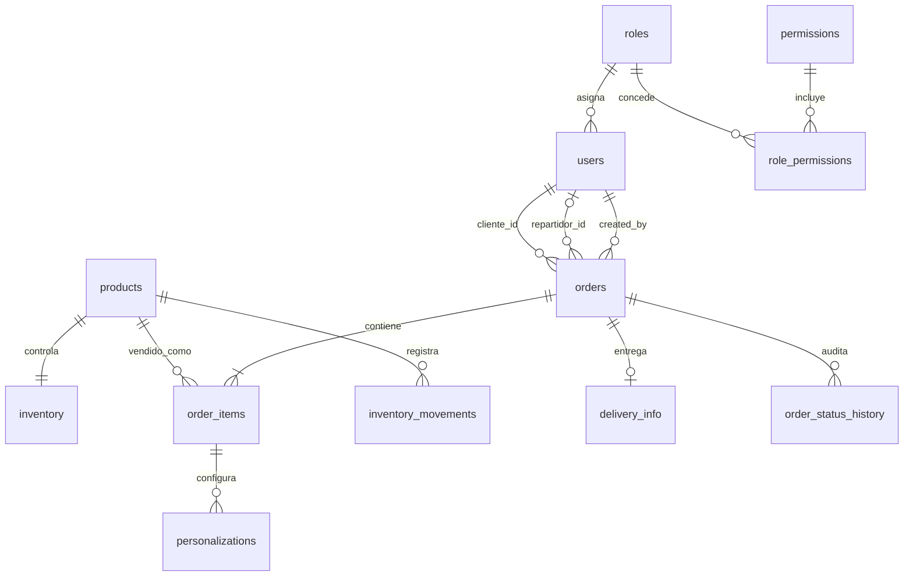

# BurgerFlow

Prototipo académico de gestión de restaurante. Conserva las pantallas HTML/CSS/JavaScript existentes y las conecta a una API Node.js/Express con SQLite persistente. No es React y no requiere convertir la interfaz.

## Requisitos

- Node.js 20.19+ (validado con Node.js 24).
- npm.

## Estructura del repositorio

```text
.
├── .github/workflows/          # Verificación automática de las pruebas
├── backend/                    # API Express, SQLite, sesiones y migraciones
├── docs/                       # Informes técnicos en Markdown y PDF
├── mockup/                     # Páginas BurgerFlow, estilos y cliente de interfaz
├── supabase/                   # Configuración de Supabase CLI para Cloud
├── .env.example                # Plantilla de configuración, sin secretos reales
├── package.json                # Scripts y dependencias del proyecto
├── package-lock.json           # Versiones reproducibles de dependencias
├── README.md                   # Arquitectura, instalación y uso
└── SUPABASE_SETUP.md           # Estado y pasos de integración Supabase
```

La interfaz permanece en `mockup/` porque Express la publica directamente; `backend/` conserva la API y su SQLite local. No se trasladan estos directorios a `src/` o `public/`, nombres que corresponderían a otra arquitectura y podrían romper rutas existentes. GitHub ordena las entradas de cada directorio automáticamente.

## Preparación Supabase Cloud

La CLI y `@supabase/supabase-js` están instalados para una integración futura. BurgerFlow continúa usando SQLite; el cliente Supabase aún no está conectado al servidor y no se han creado tablas ni migraciones remotas. Revisa el [informe técnico en PDF](docs/supabase-cloud-report.pdf), su [fuente Markdown](docs/supabase-cloud-report.md) y la [guía de configuración](SUPABASE_SETUP.md). La autenticación CLI y la clave publishable local siguen pendientes.

## Ejecución local en Windows

En PowerShell, desde la raíz del repositorio:

```powershell
Copy-Item .env.example .env
npm install
npm run db:migrate
npm run db:seed
npm start
```

Abre <http://localhost:3000>. El servidor entrega la maqueta y la API desde el mismo origen; abrir un HTML con `file://` no conecta a la base de datos. Para desarrollo con reinicio automático usa `npm run dev`. Las tablas también se migran y los datos de demostración se aseguran al iniciar el servidor.

`backend/data/burgerflow.sqlite` contiene la base persistente y está excluida de Git. `DATABASE_PATH` permite cambiar su ruta. Define un `SESSION_SECRET` aleatorio y exclusivo antes de publicar el servicio. Si no está definido en modo local, el servidor genera uno temporal y las sesiones se invalidan al reiniciarlo. No uses esa configuración de desarrollo en producción.

## Cuentas ficticias para pruebas locales

Todas usan el valor configurado en `DEMO_PASSWORD`; de forma predeterminada es `ChangeThisDemoPassword1!`. El hash se genera con bcryptjs (factor 12). Cambia `DEMO_PASSWORD` antes de la primera carga de datos si lo prefieres; volver a sembrar no reemplaza contraseñas que ya existan.

| Rol | Usuario |
|---|---|
| Administrador | `admin@burgerflow.local` |
| Cajero | `cajero@burgerflow.local` |
| Cocinero | `cocina@burgerflow.local` |
| Delivery | `delivery@burgerflow.local` |
| Repartidor A | `repartidor-a@burgerflow.local` |
| Repartidor B | `repartidor-b@burgerflow.local` |
| Cliente | `cliente@burgerflow.local` |

Son cuentas y datos ficticios para pruebas locales; no reutilices la contraseña ni publiques una base SQLite con datos reales.

## Base de datos y relaciones

Las migraciones versionadas están en `backend/migrations/`. La inicialización crea:

- `roles`, `permissions`, `role_permissions`, `users`: identidad, roles y autorización.
- `products`, `inventory`, `inventory_movements`: catálogo, existencias por producto y auditoría de ajustes.
- `orders`, `order_items`, `personalizations`: pedido, propietario `cliente_id`, reparto opcional `repartidor_id`, precios/cantidades históricos y opciones de personalización.
- `delivery_info`: nombre, teléfono y dirección asociados por pedido, aislados de los datos generales de la orden.
- `order_status_history`: registro de cada transición de estado.
- `session_store`: sesiones persistidas en SQLite con vencimiento.



Las tablas usan claves foráneas, restricciones `CHECK`, índices de consulta e importes enteros en centavos de boliviano. `cliente_id` es obligatorio y referencia `users` con rol `customer`; `repartidor_id` es opcional y debe apuntar a `users` con rol `delivery`. La migración 003 mantiene `created_by` como autor operativo, rellena los pedidos previos y añade triggers para hacer cumplir la presencia y rol de esas cuentas. La cuenta de cliente de mostrador es el propietario predeterminado de pedidos creados desde POS si no se proporciona un cliente; las sesiones del rol cliente siempre se asocian a sí mismas y no pueden suplantar otro ID. El stock del prototipo es una cantidad por producto final: aún no modela recetas ni consumo de ingredientes.

## API y operaciones

| Operación | Endpoint | Autorización |
|---|---|---|
| Leer catálogo activo | `GET /api/products` | Público; solo nombres, categorías y precios activos |
| Crear/editar/desactivar producto | `POST/PATCH/DELETE /api/products` | Administrador; DELETE desactiva y no borra el historial |
| Consultar/ajustar inventario | `GET/PATCH /api/inventory/:productId` | Administrador |
| Crear pedido | `POST /api/orders` | Cliente, Cajero o Administrador |
| Leer pedidos | `GET /api/orders` | Admin/Cajero: lista operativa; Cliente: propios |
| Leer pedido individual | `GET /api/orders/:id` | Delivery: solo si `repartidor_id` coincide con su sesión; Cliente: solo si `cliente_id` coincide; Cajero/Admin según rol |
| Corregir entrega antes de cocina | `PATCH /api/orders/:id/delivery` | Cliente/Cajero titular del pedido o Administrador; solo estado `pending` |
| Leer cola de cocina | `GET /api/orders/kitchen` | Cocinero/Admin; sin datos de entrega ni importes |
| Leer entregas asignadas | `GET /api/orders/delivery` | Delivery/Admin; solo pedidos asignados al usuario |
| Cambiar estado | `PATCH /api/orders/:id/status` | Cocina y delivery según su flujo; Admin según transiciones |
| Asignar delivery | `PATCH /api/orders/:id/assign` | Administrador |
| Consultar/crear/desactivar cuentas | `GET/POST/PATCH /api/users` | Administrador |
| Consultar métricas | `GET /api/dashboard` | Administrador |

El pedido se crea en una transacción SQLite: el servidor verifica productos activos, inventario y cantidades enteras positivas; obtiene los precios de la base; calcula subtotal, impuesto del 8% y cargo fijo de servicio de Bs 0,50; guarda líneas, personalizaciones, entrega e historial; y descuenta existencias. Si falla una condición, no queda un pedido parcial. El precio unitario original queda guardado en cada línea. La cancelación permitida revierte el stock y deja trazabilidad.

## Roles y privacidad

- **Administrador:** productos, inventario, usuarios, pedidos e indicadores.
- **Cajero:** pedidos operativos y cancelación de pedidos pendientes/en preparación; no consulta direcciones de entrega.
- **Cocinero:** artículos y personalizaciones necesarios; solo transiciones `pending → preparing → ready`.
- **Delivery:** solo pedidos asignados; transiciones `ready → out_for_delivery → delivered`; recibe los datos de contacto imprescindibles para esa entrega.
- **Cliente:** catálogo, pedido y lectura de sus propios pedidos; información de entrega asociada al pedido propio.

La aplicación aplica permisos en Express, no por ocultar enlaces. Las contraseñas no se devuelven en API; las contraseñas almacenadas son hashes bcrypt. La cookie de sesión es `HttpOnly`, `SameSite=Strict`, con vencimiento; usa `Secure` cuando `NODE_ENV=production`. Las mutaciones rechazan `Origin` de otro host y las rutas de login tienen limitación de intentos. El endpoint de cocina y las consultas del cajero omiten `delivery_info`; el endpoint de delivery filtra por el ID de repartidor de la sesión.

La consulta individual `GET /api/orders/:id` carga primero el pedido; para un repartidor compara `orders.repartidor_id` con el ID de `req.session.user`. Si no coinciden (o el pedido no existe/no es delivery), responde `404` genérico sin serializar nombre, teléfono ni dirección. No usa IDs de usuario enviados por el cliente.

## Interfaz integrada

- Inventario: consulta, alta, edición básica, ajuste de existencias y desactivación persistente; muestra los valores con nodos de texto.
- POS: lee catálogo/precios actuales y crea pedidos en servidor.
- Menú, personalización y carrito: mantienen el borrador temporal en `sessionStorage`; al confirmar, la API vuelve a validar cantidades, existencias y precios.
- Cocina: consulta la cola persistida y actualiza estados permitidos.
- Delivery: consulta únicamente las entregas asignadas y actualiza su estado; no usa mapa ni contacto externo real.
- Paneles: el resumen de pedidos, ventas del día y alertas de inventario se leen de la base. Gráficos semanales y reportes avanzados siguen siendo ilustrativos.

## Pruebas

```powershell
npm test
npm run test:assignment
npm audit
```

La suite automatizada cubre autenticación y permisos, CRUD de productos, persistencia al reiniciar SQLite, precio oficial del servidor, cantidades inválidas, inventario insuficiente, aislamiento de datos de entrega, pertenencia de delivery, transiciones de estado y reversión de existencias. `npm run test:assignment` ejecuta la demostración específica del docente: A puede consultar dos pedidos asignados; B recibe `404` para esos mismos IDs sin recibir datos personales. También se comprueba que la migración preserva asignaciones existentes y que los triggers rechazan cuentas con roles incorrectos.

## Límites y despliegue

- No se procesan pagos reales, no existe integración con pasarelas ni servicios externos.
- No hay registro público de clientes ni pantalla de administración de usuarios/roles; la API ofrece operaciones administrativas básicas.
- La asignación inicial de delivery elige una cuenta activa de demostración; no hay algoritmo de despacho.
- Las personalizaciones permitidas (tamaño y extras) reciben recargos calculados por el servidor y quedan guardadas como instantáneas de precio; el inventario no descuenta ingredientes mediante recetas.
- La actualización de cocina y delivery consulta cada 15 segundos; no hay WebSocket.
- No es una configuración de producción: hace falta HTTPS, secretos gestionados, respaldos, política de retención/privacidad, observabilidad y revisión de seguridad operativa.
- GitHub Pages solo sirve la parte estática y no ejecuta Node ni SQLite. Para usar CRUD, el backend debe ejecutarse en una máquina/servicio Node con almacenamiento persistente; frontend y API deben compartir origen o configurarse con CORS/CSRF seguros antes de separarlos.

El análisis académico actualizado está en [`docs/analisis-entidad-crud-seguridad.md`](docs/analisis-entidad-crud-seguridad.md).
