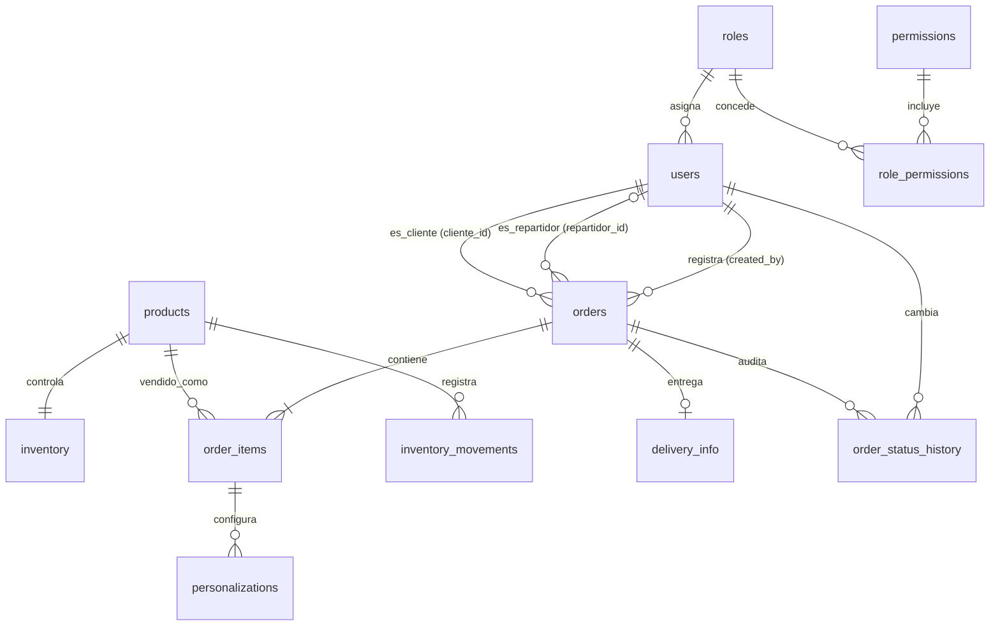

# Análisis técnico de entidad, CRUD y seguridad — BurgerFlow

**Fecha de actualización:** 11 de noviembre de 2026
**Alcance:** prototipo local de persistencia, API y controles de acceso.

## 1. Descripción breve del sistema

BurgerFlow conserva sus pantallas originales en HTML, CSS y JavaScript; no es una aplicación React. Ahora puede ejecutarse con Node.js, Express y SQLite para persistir catálogo, inventario y pedidos. El recorrido integrado enlaza el menú, personalización, carrito/POS, cocina y reparto mediante una API local. No procesa pagos reales ni debe confundirse con un servicio listo para producción.

## 2. Entidad principal: Pedido

**Justificación.** `Pedido` conecta la selección del cliente o cajero con el inventario, la preparación de cocina y la entrega. Se persiste con líneas históricas y transiciones auditadas. Se separó la información de entrega para limitar la exposición de datos personales. El esquema original está en [001-initial-schema.sql](../backend/migrations/001-initial-schema.sql) y la corrección incremental en [003-order-customer-and-driver.sql](../backend/migrations/003-order-customer-and-driver.sql); creación y serialización están en [app.js](../backend/app.js).

Los importes monetarios se almacenan en centavos enteros de boliviano. “Obligatorio” refleja `NOT NULL`, claves o restricciones de la migración; la obligatoriedad condicional (por ejemplo, dirección solo en delivery) se valida en la API. Como la migración es aditiva para conservar datos previos, SQLite declara `cliente_id` nullable en `table_info`, pero triggers de inserción y actualización rechazan valores nulos y cuentas que no tengan rol `customer`.

| Campo | Tipo de dato | Descripción | Obligatorio | Sensible |
|---|---|---|---|---|
| `orders.id` | Entero, clave primaria | Identificador interno. | Sí | No |
| `orders.code` | Texto único | Código público del pedido. | Sí | No |
| `orders.created_by` | Entero, FK a `users` | Cuenta autenticada que registró el pedido; se conserva como autor operativo. | Sí | Dato operativo |
| `orders.cliente_id` | Entero, FK a `users` | Cliente propietario. Debe referenciar una cuenta con rol `customer`; el backend asigna la identidad desde la sesión del cliente. | Sí | Identificador de cuenta |
| `orders.repartidor_id` | Entero, FK a `users`, nullable | Repartidor asignado. Debe ser una cuenta activa con rol `delivery`. | No | Identifica trabajador |
| `orders.order_type` | Enum textual | `dine_in`, `pickup` o `delivery`. | Sí | No |
| `orders.status` | Enum textual | `pending`, `preparing`, `ready`, `out_for_delivery`, `delivered` o `cancelled`. | Sí | No |
| `orders.payment_method` | Enum textual | `cash`, `card` o `qr`; no contiene datos de tarjeta. | Sí | Dato transaccional |
| `orders.subtotal_cents`, `tax_cents`, `service_cents`, `total_cents` | Enteros no negativos | Importes calculados por servidor; total sujeto a restricción de suma. | Sí | Dato financiero |
| `orders.created_at` | Fecha/hora textual | Fecha de creación en SQLite. | Sí, valor por defecto | No |
| `order_items.id` | Entero, clave primaria | Identificador de la línea. | Sí | No |
| `order_items.order_id`, `product_id` | Enteros, claves foráneas | Pedido y producto relacionado. | Sí | No |
| `order_items.product_name` | Texto | Nombre conservado como instantánea histórica. | Sí | No |
| `order_items.quantity` | Entero positivo | Unidades solicitadas y descontadas del stock del producto. | Sí | No |
| `order_items.unit_price_cents`, `line_total_cents` | Enteros | Precio oficial de la compra y total de línea congelados al confirmar. | Sí | Dato financiero |
| `personalizations.id`, `order_item_id`, `name`, `value`, `price_delta_cents` | Enteros/FK/texto | Opción solicitada; el backend calcula y conserva la diferencia de precio permitida. | Sí, si hay opción | Puede revelar preferencias alimentarias |
| `delivery_info.id`, `order_id`, `customer_name`, `phone`, `address`, `created_at` | Entero/FK/texto/fecha | Información mínima de entrega, asociada de forma única al pedido. Solo se requiere para `delivery`. | Condicional | Sí: identificadores y ubicación |
| `order_status_history.id`, `order_id`, `changed_by`, `old_status`, `new_status`, `changed_at` | Enteros/FK/texto/fecha | Auditoría de transiciones de estado. | Sí para cada cambio | Dato operativo asociado a usuario |

`delivery_info` tiene clave foránea única por pedido y no se devuelve en el endpoint de cocina ni en la lista operativa del cajero. La API puede devolverla al administrador, al cliente propietario y al repartidor asignado. No se guardan PAN, CVV ni credenciales de pago.

### Comparación conceptual y esquema implementado

El diagrama del docente representa el modelo conceptual: un cliente tiene muchos pedidos, cada pedido pertenece a un cliente y puede tener cero o un repartidor; cada pedido contiene una o más líneas. El esquema real reutiliza `users` y sus roles `customer` y `delivery`; no crea tablas duplicadas `clientes` o `repartidores`.

En SQLite, `cliente_id` y `repartidor_id` referencian `users(id)`. Una migración actualiza los registros previos y triggers impiden guardar un pedido sin cliente o asignar una cuenta de rol incorrecto. `created_by` sigue registrando qué sesión creó el pedido; no sustituye al propietario `cliente_id`. Los pedidos previos creados por personal se atribuyen a la cuenta ficticia de cliente de mostrador, conservando el autor en `created_by`.

| Aspecto | Propuesta conceptual del docente | Implementación verificable |
|---|---|---|
| Cliente titular | Entidad Cliente separada | `users` con rol `customer`; FK `orders.cliente_id` obligatoria, validada por trigger |
| Repartidor | Entidad Repartidor separada | `users` con rol `delivery`; FK opcional `orders.repartidor_id`, validada por trigger y backend |
| Líneas | Una o varias por pedido | `order_items.order_id` es FK; la creación de pedidos exige al menos una línea |
| Dirección | Atributo de pedido en el diagrama | Tabla `delivery_info` separada por privacidad, relacionada uno a uno con el pedido |

### Diagrama relacional implementado

La relación de inventario representa unidades disponibles por producto terminado. No existe todavía una lista de ingredientes ni una receta que descuente insumos por composición.

## 3. Matriz CRUD y permisos

Los roles `admin`, `cashier`, `kitchen`, `delivery` y `customer` y sus permisos se cargan en SQLite; Express vuelve a comprobarlos en cada operación protegida. Los enlaces y pantallas no conceden autorización.

| Entidad o dato | Crear | Leer | Actualizar | Eliminar |
|---|---|---|---|---|
| Catálogo de productos | Administrador | Público: productos activos; personal: catálogo | Administrador | Administrador: baja lógica; no se borra físicamente |
| Inventario | Administrador al crear producto | Administrador | Administrador: ajuste auditado; pedido: descuento transaccional | No permitido directamente |
| Pedido y líneas | Cliente, Cajero o Administrador | Admin/Cajero: operación; Cliente: propios por `cliente_id`; Cocina: cola mínima; Delivery: solo asignados por `repartidor_id`, también en `GET /api/orders/:id` | Cocina: `pending → preparing → ready`; Delivery asignado: `ready → out_for_delivery → delivered`; Administrador según transiciones | Sin borrado físico; Cajero/Administrador pueden cancelar en estados permitidos |
| Personalizaciones | Cliente/Cajero/Administrador al crear pedido | Solo mediante vistas del pedido autorizadas; Cocina recibe lo necesario | No disponible después de confirmar | Se conserva en historial |
| Nombre, teléfono y dirección de entrega | Cliente/Cajero/Administrador al crear pedido de delivery | Administrador; Cliente propietario; Delivery únicamente si su ID de sesión coincide con `repartidor_id`. No Cocina ni Cajero | Cliente titular o Cajero autor del pedido o Administrador, solo si sigue `pending` | No hay borrado individual; política de retención pendiente |
| Usuarios | Administrador mediante API | Administrador mediante API | Administrador puede activar/desactivar; cambio de rol no disponible | Baja lógica; no se borra físicamente |
| Roles y permisos | Migración/datos iniciales | Administrador puede consultar usuarios, no hay endpoint de permisos | No hay interfaz/endpoint para modificar permisos | Solo mediante migración controlada |

### Estado funcional observado

- **Implementado y persistente:** catálogo activo, alta/edición/baja lógica de productos; consulta y ajuste de stock con movimientos auditados; creación de pedidos desde carrito/POS; precios e importes calculados en servidor; instantánea de precio en cada línea; decremento y reversión del inventario dentro de transacciones; cola de cocina; estados permitidos; listado de delivery asignado; métricas administrativas; cuentas, roles y sesiones.
- **Interfaz conectada:** menú/selector de producto, carrito, inventario, POS, KDS, delivery y algunos indicadores. Los borradores del carrito y personalización permanecen en `sessionStorage` hasta confirmar; todavía no son pedidos persistentes.
- **Disponible en API, sin pantalla de administración:** creación y desactivación de usuarios, listado de cuentas y asignación manual de delivery.
- **Protección verificada para el requisito docente:** `GET /api/orders/:id` devuelve datos de entrega a un repartidor solo cuando el pedido es delivery y `orders.repartidor_id` coincide con la cuenta autenticada. Una cuenta ajena recibe `404` genérico sin campos personales; cambiar el ID de la URL no cambia esa comprobación.
- **No implementado:** edición de datos de entrega después de iniciar la preparación, registro público de clientes, cambio de roles/permisos, eliminación física de historial, pasarela de pago, mapas/contacto reales, recetas de ingredientes y reportes/gráficos semanales basados en datos. Algunas acciones visuales de los paneles siguen siendo ilustrativas.

## 4. Regla indispensable de seguridad

**Regla:** los controles de autorización y el acceso a datos personales deben aplicarse en el servidor según identidad, rol y relación con el pedido; nunca deben depender de una pantalla, enlace o botón del frontend.

**Por qué es indispensable.** Una dirección de entrega permite localizar a una persona. Un usuario que cambie manualmente una URL o una petición no debe obtener entregas ajenas ni información innecesaria para su función.

**Código relacionado.** Las sesiones se validan en [app.js](../backend/app.js); `GET /api/orders/:id` compara el `repartidor_id` del pedido con el ID procedente de la sesión antes de serializar la dirección. El endpoint de lista aplica el mismo filtro; cocina y cajero reciben proyecciones sin los datos de entrega. Las pruebas de [app.test.js](../backend/app.test.js) verifican las dos identidades de repartidor, la consulta individual y los intentos con IDs de pedido cambiados manualmente.

**Estado:** implementada y verificada en el prototipo local con pruebas automatizadas. Para el usuario permitido, la consulta devuelve la dirección; para el no asignado, responde `404` sin datos personales. Esto no demuestra el despliegue seguro de un servicio público. Las cuentas son de demostración, el `SESSION_SECRET` debe configurarse para un entorno persistente y el despliegue requiere HTTPS, almacenamiento protegido, respaldo y política de retención.

**Aplicación necesaria fuera del entorno local:** desplegar API tras HTTPS, provisionar secretos fuera del repositorio, conservar la base en almacenamiento persistente con acceso restringido, controlar sesiones y registros, mantener permisos mínimos y definir eliminación/anonimización de datos cuando expire su finalidad.

## 5. Duda técnica específica y respuesta

**Pregunta:** ¿puede un repartidor obtener la dirección de un pedido de otro repartidor cambiando el ID en `/api/orders/:id` o enviando otro ID de usuario desde el navegador?

**Respuesta:** no por las rutas comprobadas: el backend toma la identidad exclusivamente de la sesión, carga el pedido por su ID y solo después compara `repartidor_id` con el usuario autenticado. Un repartidor no asignado recibe `404` con el mensaje genérico `Pedido no encontrado.`; ni la dirección, teléfono ni nombre se serializan. Las pruebas también repiten la petición con IDs de pedidos que sí existen, asignados a la cuenta A. Además, los precios se obtienen del catálogo y los importes se calculan en servidor.

**Prueba reproducible A/B:** ejecutar `npm run test:assignment`. La prueba inicia sesión con `repartidor-a@burgerflow.local` y `repartidor-b@burgerflow.local`, crea dos pedidos ficticios y los asigna solo a A. A obtiene `200` y los datos de entrega; B consulta exactamente las mismas URLs, incluso añadiendo un `userId` ajeno en query, y obtiene `404` sin datos personales. Las cuentas usan la contraseña local configurada por `DEMO_PASSWORD`; el test automático usa una contraseña aislada propia y una SQLite en memoria.

**Riesgo residual:** datos de demostración y pantallas no conectadas no deben interpretarse como datos reales o control de acceso. GitHub Pages puede exponer archivos estáticos, pero no ejecuta el backend; no se debe publicar una base SQLite con datos personales. La asignación automática al primer repartidor activo es solo una regla de demostración y requiere una política operativa real.

**Recomendación concreta:** mantener el filtro de autorización en cada consulta/actualización del servidor, devolver solo los campos indispensables, no permitir que el navegador envíe precios oficiales, y añadir pruebas de regresión cuando cambien las rutas o permisos.

## 6. Conclusión

BurgerFlow pasó de una maqueta estática a un prototipo local verificable con SQLite persistente, operaciones CRUD selectivas, roles, sesiones, auditoría y flujos reales de inventario y pedidos. Pedido es la entidad central; cada fila identifica al cliente titular y al autor operativo, y opcionalmente al repartidor asignado. La prueba A/B y las 12 pruebas automatizadas verifican la migración, las claves foráneas, la exposición limitada de direcciones y la denegación para repartidores no asignados. Antes de usar datos reales o publicar el servicio se requieren HTTPS, secretos administrados, almacenamiento y respaldos seguros, reglas de retención y una revisión de seguridad del despliegue.

## Referencias de implementación

- [Autenticación y autorización de sesión](../backend/app.js#L81)
- [CRUD de productos e inventario](../backend/app.js#L166)
- [Pedidos, vistas por rol, consulta individual y cálculo transaccional](../backend/app.js#L286)
- [Consulta individual del pedido y autorización del repartidor asignado](../backend/app.js#L317)
- [Actualización protegida de datos de entrega](../backend/app.js#L443)
- [Esquema de pedidos, líneas y entrega](../backend/migrations/001-initial-schema.sql#L46)
- [Migración de cliente titular y repartidor asignado](../backend/migrations/003-order-customer-and-driver.sql)
- [Migración de sesiones](../backend/migrations/002-sqlite-session-store.sql)
- [Inicialización y datos ficticios](../backend/db.js)
- [Prueba de acceso individual asignado/no asignado](../backend/app.test.js#L169)
- [Prueba de migración y claves foráneas](../backend/app.test.js#L200)
- [Integración de carrito, POS, cocina y reparto](../mockup/api-client.js#L215)
- [Listado protegido y cambios de estado de reparto](../mockup/api-client.js#L718)
- [Pantalla de delivery](../mockup/panel_de_delivery/code.html#L175)
- [Guía de ejecución](../README.md)
