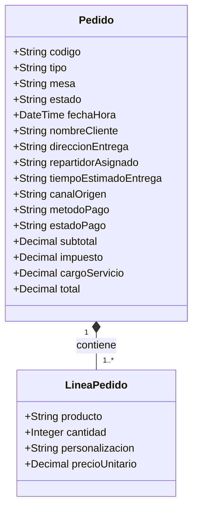

# Análisis de entidad, operaciones CRUD y seguridad — BurgerFlow

## Alcance y limitaciones

La inspección encontró un prototipo estático bajo `mockup/`, no un proyecto React: no hay `package.json`, fuentes `.jsx`/`.tsx`, modelos tipados ni configuración de rutas de React en el workspace. El README identifica el entregable como una maqueta navegable que se abre desde `index.html` y no requiere servidor ([README.md](../mockup/README.md#L1), [README.md](../mockup/README.md#L5)). Por tanto, las páginas y operaciones descritas a continuación son evidencia de la interfaz y de interacciones locales, no de un sistema con backend, usuarios autenticados o datos persistidos. Los archivos HTML cargan recursos de presentación externos y `navigation.js`; no se observó cliente HTTP, endpoint ni conexión de base de datos.

## 1. Descripción breve del sistema

BurgerFlow representa la gestión operativa de un restaurante y el flujo de compra de sus productos. Incluye vistas de panel, POS, menú de clientes, carrito, inventario, cocina y reparto, conectadas mediante enlaces entre archivos HTML. Las pantallas muestran pedidos, productos, ventas y estados de preparación, pero la mayoría de sus datos son estáticos o se modifican solo en el DOM del navegador. No se encontró conexión con una base de datos ni autenticación real.

## 2. Entidad principal: Pedido

**Justificación.** Se selecciona `Pedido` porque articula el recorrido funcional central: el cliente configura productos y revisa el carrito, el POS representa la venta, cocina muestra su preparación y delivery muestra su despacho. La lámina de arquitectura también describe el flujo menú → personalización → carrito → orden ([arquitectura-componentes.svg](../mockup/arquitectura-componentes.svg#L54), [arquitectura-componentes.svg](../mockup/arquitectura-componentes.svg#L69)). Esta es una elección analítica; no existe una entidad `Pedido` formalmente declarada en código.

No existe una interfaz, tipo o modelo explícito de `Pedido`; los atributos siguientes se infieren de los textos y controles de las pantallas. Los ejemplos de nombres, direcciones y pedidos aparecen como contenido de demostración y no permiten afirmar que correspondan a personas reales.

| Campo | Tipo de dato | Descripción | Obligatorio | Sensible |
|---|---|---|---|---|
| `codigo` | Cadena (inferido) | Identificador visible del pedido, por ejemplo `#BF-1024` o `#ORD-8492`. | Sí en la presentación; restricción de datos no especificada. | No |
| `items` | Lista de `LineaPedido` (inferido) | Productos incluidos en el pedido y sus cantidades. | Sí para una compra; validación no especificada. | No |
| `items.producto` | Cadena (inferido) | Nombre del producto o artículo solicitado. | Sí en los ejemplos mostrados. | No |
| `items.cantidad` | Entero (inferido) | Unidades de cada artículo; el selector de personalización tiene mínimo visual de 1. | Sí en los ejemplos; validación integral no especificada. | No |
| `items.personalizacion` | Lista/cadena (inferido) | Tamaño, extras o ingredientes que se agregan o se retiran. | No; depende de la selección del cliente. | Puede revelar preferencias alimentarias; sensibilidad no especificada. |
| `items.precioUnitario` | Número decimal (inferido) | Precio mostrado para cada producto del carrito. | No especificado en el modelo; sí aparece en la interfaz. | Dato comercial |
| `tipo` | Cadena/enum (inferido) | Modalidad del pedido: comer en el local, para llevar o delivery. | Sí para el flujo mostrado; restricción formal no especificada. | No |
| `mesa` | Cadena o número (inferido) | Mesa asociada a pedidos de consumo en el local. | Condicional al tipo de pedido; validación no especificada. | No |
| `estado` | Cadena/enum (inferido) | Situación operativa: nuevo, en cocina/preparación, listo o en camino. | Sí para seguimiento; transición permitida no especificada. | No |
| `fechaHora` | Fecha/hora (inferido) | Hora o antigüedad mostrada para pedidos de cocina y panel. | No especificado. | No |
| `nombreCliente` | Cadena (inferido) | Nombre mostrado para una entrega. | No especificado; aparece en la vista de delivery. | Sí: dato personal identificable. |
| `direccionEntrega` | Cadena (inferido) | Dirección de destino del pedido a domicilio. | Condicional a delivery; validación no especificada. | Sí: dato personal y de ubicación. |
| `repartidorAsignado` | Cadena (inferido) | Nombre/identificador de repartidor asignado al pedido. | Condicional a delivery; regla de asignación no especificada. | Sí: identifica a una persona trabajadora. |
| `tiempoEstimadoEntrega` | Duración/fecha-hora (inferido) | Tiempo estimado que aparece en el seguimiento de delivery. | No especificado; puede estar ausente. | No |
| `canalOrigen` | Cadena (inferido) | Canal o proveedor que aparece en pedidos de delivery (p. ej., UberEats o DoorDash). | No especificado. | Dato comercial |
| `metodoPago` | Cadena/enum (inferido) | Selección visible: efectivo, tarjeta o QR. No se muestran PAN, CVV ni credenciales de pago. | Sí en la interacción del checkout (`required`). | No por sí solo; no se observan credenciales de pago. |
| `estadoPago` | Cadena/enum (inferido) | Etiqueta de pago como “Pagado en línea” o “Pago contra entrega”. | No especificado como campo; visible en delivery. | Sí: información transaccional. |
| `subtotal`, `impuesto`, `cargoServicio`, `total` | Número decimal (inferido) | Importes del resumen y total calculado en el carrito. | No especificado como modelo; aparecen en la interfaz. | Sí: información financiera/transaccional. |

El checkout muestra artículos, importes y método de pago en [code.html](../mockup/carrito_y_confirmaci_n/code.html#L145) y [code.html](../mockup/carrito_y_confirmaci_n/code.html#L236); el número y estado de confirmación son contenido demostrativo en [code.html](../mockup/carrito_y_confirmaci_n/code.html#L254). La vista de delivery muestra identificador, nombre, estado, dirección, estado de pago y estimación ([code.html](../mockup/panel_de_delivery/code.html#L194), [code.html](../mockup/panel_de_delivery/code.html#L203), [code.html](../mockup/panel_de_delivery/code.html#L206), [code.html](../mockup/panel_de_delivery/code.html#L207)); el panel de detalle muestra repartidor, artículos y total ([code.html](../mockup/panel_de_delivery/code.html#L281), [code.html](../mockup/panel_de_delivery/code.html#L282), [code.html](../mockup/panel_de_delivery/code.html#L292), [code.html](../mockup/panel_de_delivery/code.html#L315)). Cocina ilustra cantidad, personalización, hora y canal de origen ([code.html](../mockup/monitor_de_cocina_kds/code.html#L152), [code.html](../mockup/monitor_de_cocina_kds/code.html#L228), [code.html](../mockup/monitor_de_cocina_kds/code.html#L328)).

### Diagrama conceptual

El diagrama es una propuesta conceptual inferida de la interfaz, no un esquema de base de datos existente.

## 3. Matriz CRUD y permisos

Los nombres de rol que se ven en el panel son `Jefe / Admin`, `Cajero`, `Cocinero`, `Delivery` y `Cliente` ([index.html](../mockup/index.html#L139)). **Son etiquetas de acceso a pantallas, no roles autenticados ni permisos implementados.** La distribución de permisos de esta tabla es una propuesta para un backend futuro, basada en las funciones indicadas por esas pantallas.

| Entidad o dato | Crear | Leer | Actualizar | Eliminar |
|---|---|---|---|---|
| Pedido y artículos | Cliente (pedido propio); Cajero (venta asistida) — propuesta | Cliente (propio); Cajero y Admin; Cocinero (cola necesaria); Delivery (solo asignados) — propuesta | Cajero antes de enviar; Cocinero actualiza solo estados de preparación; Delivery solo estados de reparto asignado; Admin — propuesta | Admin mediante cancelación auditada; Cliente solo antes de confirmarse — propuesta |
| Nombre y dirección de entrega | Cliente al solicitar delivery — propuesta | Cliente (propio); Delivery asignado; Cajero solo si es necesario; Admin — propuesta | Cliente antes de confirmar; Admin con motivo y auditoría — propuesta | Admin según política de retención; preferir anonimización cuando proceda — propuesta |
| Repartidor asignado y estimación | Admin/operación asigna repartidor; sistema estima entrega — propuesta | Delivery asignado y personal operativo que lo requiera — propuesta | Admin/operación reasigna; repartidor actualiza hitos permitidos — propuesta | Admin al desasignar o cancelar; conservar auditoría según política — propuesta |
| Estado del pedido | Sistema al crear el pedido — propuesta | Cliente (propio) y personal según su tarea — propuesta | Cocinero: preparación/listo; Delivery: estados de despacho asignado; Admin: corrección auditada — propuesta | No borrar físicamente como operación ordinaria; cancelar mediante flujo auditado — propuesta |
| Método/estado de pago e importes | Sistema calcula importes; Cliente/Cajero selecciona método — propuesta | Cliente (propio), Cajero y Admin; no se requiere para Cocina — propuesta | Recalcular en servidor; estado conciliado por personal autorizado y auditado — propuesta | No eliminar aisladamente el registro financiero; aplicar política de retención — propuesta |

**Estado real de las operaciones visibles:** la interfaz presenta acciones en más de un dominio; las siguientes interacciones modifican únicamente el DOM del navegador y no son CRUD persistente.

- **Crear pedido (simulado):** en POS, seleccionar un producto clona una línea y la añade al pedido visible en el DOM. En checkout, confirmar muestra un modal fijo, sin enviar ni registrar la orden. El control de checkout bloquea el modal si no hay artículos o método de pago seleccionado ([navigation.js](../mockup/navigation.js#L321), [navigation.js](../mockup/navigation.js#L333), [code.html](../mockup/carrito_y_confirmaci_n/code.html#L282), [code.html](../mockup/carrito_y_confirmaci_n/code.html#L355)). La personalización se escribe en `sessionStorage` ([code.html](../mockup/personalizar_hamburguesa/code.html#L346)); esto no equivale a persistencia de pedidos.
- **Crear inventario (simulado):** el formulario requerido añade una fila a la tabla del navegador; no se guarda en una base de datos ni sobrevive como registro del sistema ([code.html](../mockup/gesti_n_de_inventario/code.html#L254), [code.html](../mockup/gesti_n_de_inventario/code.html#L268)).
- **Leer:** se ven productos, pedidos, importes y datos de reparto definidos en el HTML; no se encontró una consulta a una fuente de datos.
- **Actualizar (simulado/incompleto):** la interfaz cambia cantidades y puede mover tarjetas de cocina a otra columna en el DOM. Los controles de edición de inventario muestran un mensaje de “disponible”, sin actualizar el producto ([navigation.js](../mockup/navigation.js#L253), [navigation.js](../mockup/navigation.js#L299)).
- **Eliminar (simulado):** el manejador de la interfaz elimina del DOM la fila, tarjeta o artículo que contiene el botón; no borra un registro persistente ([navigation.js](../mockup/navigation.js#L293), [navigation.js](../mockup/navigation.js#L296)).
- **Persistencia:** no se encontró uso de `localStorage`, API, servidor ni base de datos. El único almacenamiento observado es `sessionStorage` para una personalización del navegador.
- **Autorización:** no se encontró inicio de sesión, verificación de identidad, guardia de rutas ni autorización de servidor. Los cinco nombres de rol son enlaces a distintas páginas y no controles de acceso ([index.html](../mockup/index.html#L136), [index.html](../mockup/index.html#L143), [navigation.js](../mockup/navigation.js#L31)).

## 4. Regla indispensable de seguridad

**Regla:** Todo valor controlable por una persona debe insertarse en la página como texto, nunca interpretarse como HTML ejecutable.

**Por qué es indispensable.** El prototipo incluye una interfaz que acepta datos de un formulario. Si se convierten directamente en marcado HTML, un valor no confiable puede alterar la interfaz o ejecutar contenido en el contexto de la página. Además, el mismo principio debe mantenerse si esos datos pasan a compartirse o persistirse en una versión futura.

**Código relacionado y estado.** En la pantalla de inventario se obtienen campos del formulario con `FormData` y se interpolan en `row.innerHTML` antes de agregar la fila al DOM ([code.html](../mockup/gesti_n_de_inventario/code.html#L262), [code.html](../mockup/gesti_n_de_inventario/code.html#L267)). La regla **no se cumple en esa interacción**. Es un riesgo potencial de inyección DOM, no evidencia de XSS almacenado o remoto: no se observó persistencia ni propagación del valor a otros usuarios.

**Aplicación recomendada.** Construir las celdas mediante `document.createElement` y colocar los valores con `textContent`; validar además tipos, límites y reglas de negocio. Cuando exista backend, repetir la validación en el servidor: la validación del navegador no es una frontera de seguridad.

Como riesgo de privacidad relacionado con la entidad principal, la información personal de una entrega debería consultarse solo por el cliente titular y por personal con necesidad operativa (por ejemplo, repartidor asignado). En el estado actual esto **no puede verificarse ni garantizarse**: los nombres de roles son etiquetas y las páginas son HTML navegable sin autenticación. La vista incluye un nombre y una dirección escritos en el HTML ([code.html](../mockup/panel_de_delivery/code.html#L194), [code.html](../mockup/panel_de_delivery/code.html#L203)); no se puede afirmar que sean datos reales. Si fueran datos reales y la maqueta se publicara, podrían quedar visibles para cualquier visitante del sitio.

## 5. Duda técnica específica y respuesta

**Pregunta:** ¿Los campos `name`, `category`, `stock` y `unit` del formulario de alta de inventario se insertan en la tabla como texto seguro o se interpretan como HTML?

**Respuesta:** Se interpolan como cadenas dentro de `row.innerHTML` ([code.html](../mockup/gesti_n_de_inventario/code.html#L262), [code.html](../mockup/gesti_n_de_inventario/code.html#L267)). Por ello, si una persona introduce contenido que el navegador interpreta como marcado, existe un **riesgo potencial de inyección DOM**. El efecto observado se limita a la página abierta en esa sesión: no hay persistencia ni distribución a otros usuarios en el prototipo. No se afirma que exista XSS almacenado o remoto.

**Recomendación concreta:** sustituir la interpolación por nodos de texto (`textContent`) y aplicar validación de servidor al implementar persistencia. En producción, agregar además autenticación y autorización del lado servidor para restringir la edición del inventario y proteger los datos personales de pedidos; las rutas estáticas del frontend no sustituyen esos controles.

## 6. Conclusión

`Pedido` es la entidad de negocio que conecta las vistas principales, pero sus campos y estados solo pueden inferirse de la maqueta. El workspace inspeccionado no contiene una aplicación React ni backend, base de datos, autenticación o CRUD persistente. Hay controles de interfaz que simulan altas, cambios y eliminaciones locales; la personalización es el único dato que se guarda en `sessionStorage`. Antes de usar datos reales, deben implementarse autorización de servidor por usuario/rol y alcance del pedido, protección de datos personales, validación de reglas de negocio y renderizado seguro de entradas. Los nombres y direcciones mostrados deben confirmarse como datos sintéticos antes de publicar la maqueta.
